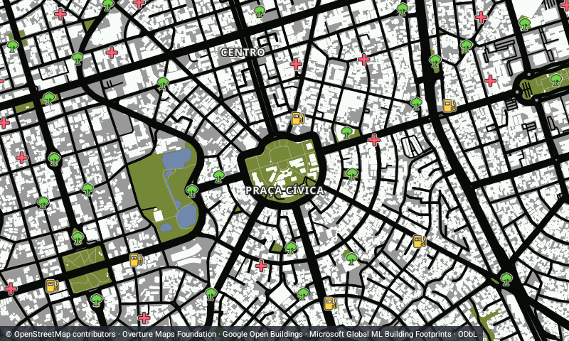
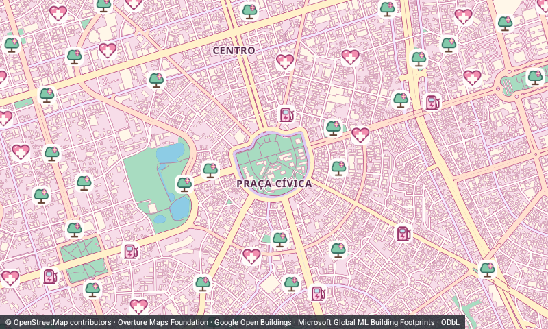

# Capturas nativas do MVP

Estas imagens foram produzidas no emulador Android 16/API 36. **Não são telas do Android Auto/DHU nem de uma central real.** A Surface dos mapas de 800 × 480 foi criada pela instrumentação para testar o mesmo renderizador usado pelo serviço.

## Dois temas, mesma câmera

GTA SA:

Rosa Pop:

[Todos os ícones desligados, áreas verdes preservadas](native-mvp-rosa-icons-hidden.png) · [Rosa noturno](native-mvp-rosa-night.png).

## Interface complementar no telefone emulado

[GTA SA](phone-gta.png) · [Rosa Pop](phone-rosa.png) · [Seleção de tema](phone-theme-dialog.png) · [Seis filtros](phone-categories-dialog.png) · [Após recriar a Activity](phone-rosa-parks-hidden.png) · [Após encerrar e reabrir o processo](phone-reopened.png).

Os arquivos `native-surface-probe*` mostram a prova mínima de geometrias, DPI, tamanho e recriação da Surface. `diagnostic-rosa.png` preserva o diagnóstico histórico de símbolos transparentes em SwiftShader; não representa o resultado final em GPU. Os detalhes, versões, testes e limites estão no [relatório de validação](../docs/VALIDATION.md).
