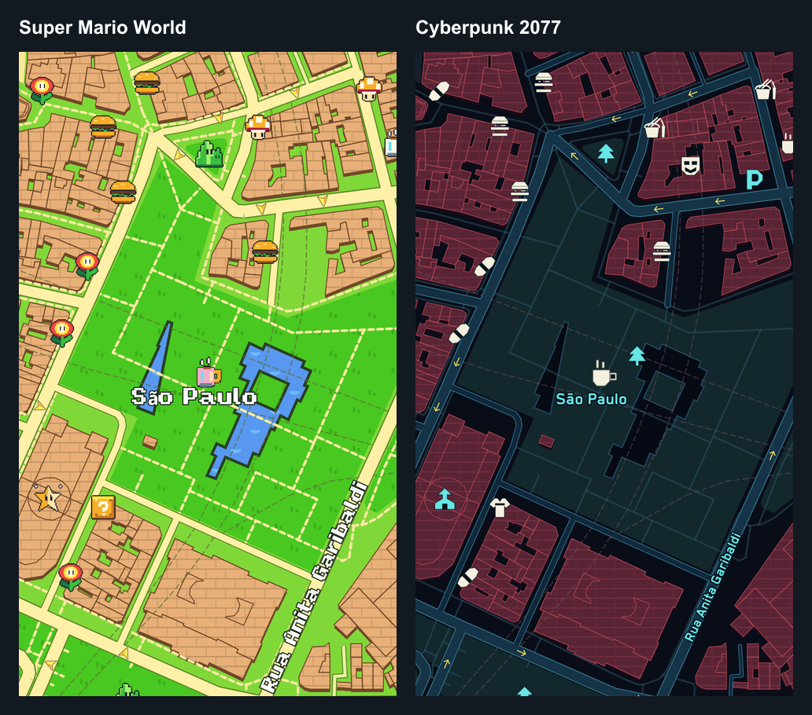

# NavSkin 0.10 · capturas nativas

Imagens do MapLibre Native OpenGL 13.7.1 em Android API 36, AVD dedicado com GPU host. As imagens `world-sao-paulo-*` mostram a mesma região e câmera, com nove categorias habilitadas. São renderizações reais dos estilos no app, sem geração de imagens por IA.

| Tema | Captura do mapa mundial |
|---|---|
| GTA SA, com ruas/POIs mais legíveis | [São Paulo](world-sao-paulo-gta.png) |
| Rosa Pop | [São Paulo](world-sao-paulo-rosa.png) |
| RDR2 | [São Paulo](world-sao-paulo-rdr2.png) |
| Super Mario World | [São Paulo](world-sao-paulo-smw.png) |
| Cyberpunk 2077 | [São Paulo](world-sao-paulo-cyberpunk.png) |

Minecraft e GTA V foram retirados desta entrega a pedido do usuário. As cinco capturas acima correspondem aos temas ativos; imagens anteriores dos estudos não fazem parte das prévias atuais.

Câmera das cinco prévias: longitude −46,6333, latitude −23,5505, zoom 16,8, rumo/inclinação zero. Os recortes 800×480 usados no carrossel são derivados dessas capturas; `android/maps/previews/index.json` registra os hashes das capturas, estilos e imagens finais.

[GTA SA na interface Vidro, em Goiânia](phone-goiania-gta.png). As imagens `nav-*-simulation.png` mostram a navegação em replay identificado, com rota controlada; não são evidência de direção em campo. Capturas da Surface mostram a superfície nativa de teste, não uma central Android Auto física.

[Desenho e referências](../../../docs/design/game-cartography-references.md) · [Validação](../../docs/VALIDATION-v0.10.md).
