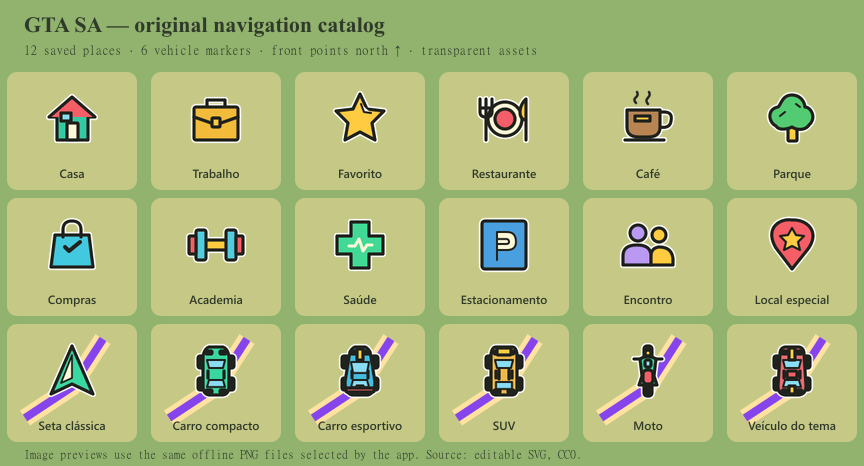
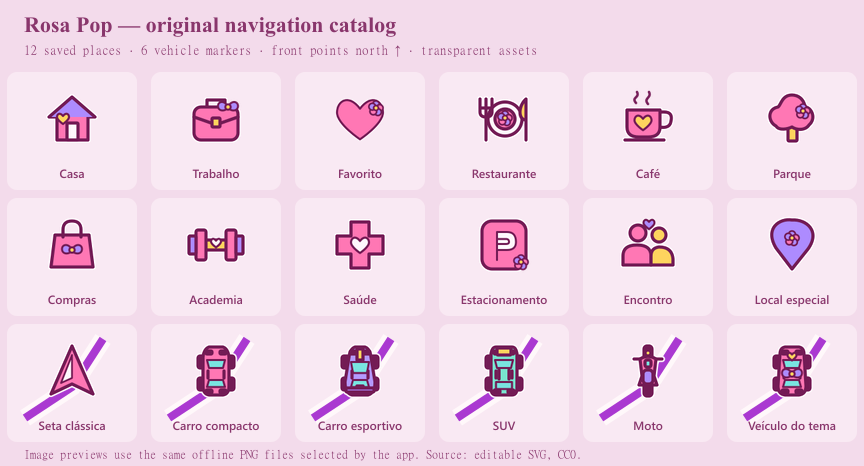
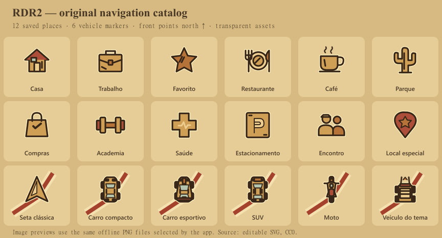

# Catálogos de locais e veículos

O projeto inclui três conjuntos: **GTA SA**, **Rosa Pop** e **RDR2**. Cada tema tem 12 ícones de locais salvos e seis marcadores de veículo. Há 54 SVGs próprios editáveis e 108 PNGs RGBA em 48×48 e 96×96. A partir da 0.7, os dois PNGs do marcador padrão GTA usam o sprite original `radar_centre`; o SVG verde anterior fica como alternativa legada. Os recursos necessários ao seletor e ao mapa são empacotados localmente.

O marcador GTA original é a exceção documentada no manifesto `rasterSource` e em [procedência dos jogos](game-assets-provenance.md). Os outros 53 desenhos são próprios, sem emojis, fontes de ícones, imagens remotas ou geometria Maki. O Rosa Pop combina formas arredondadas, corações, flores e laços próprios. O RDR2 usa tinta escura e tons de pergaminho, incluindo cacto e carroça próprios.

## Fontes e geração

As fontes ficam em `android/maps/catalogs/{gta,rosa,rdr2}/{saved,vehicles}/*.svg`. O arquivo `android/maps/catalogs/catalog.json` é o contrato editável. O resultado pronto para Android fica em `android/app/src/main/assets/navigation-icons/`.

Depois de editar um SVG ou o catálogo, execute na raiz:

```powershell
node scripts/prepare-navigation-icons.mjs
node --test tests/navigation-icons.test.mjs
node android/maps/catalogs/preview-catalogs.mjs
```

O primeiro comando copia os SVGs e gera os PNGs; preserva as alterações feitas nos SVGs de origem. Para `gta/vehicles/arrow`, valida o hash do raster local original e usa padding + nearest, em vez do SVG. A geração não depende de rede, Android SDK ou Gradle. Usa `sharp` já instalado. As pranchas geradas pelo terceiro comando mostram os SVGs de autoria; a prévia usada no seletor nativo vem do PNG final.

`android/maps/catalogs/author-original-icons.mjs` é uma ferramenta opcional de autoria, que recria a primeira versão dos 54 SVGs e do catálogo a partir de formas vetoriais. Executá-la substitui edições manuais nos SVGs. Ela não faz parte do preparo normal dos assets; use o comando `prepare-navigation-icons.mjs` para publicar edições próprias.

## Contrato para o aplicativo

O aplicativo lê `navigation-icons/catalog.json` pelo `AssetManager`. Os caminhos internos são relativos à pasta `navigation-icons`, sem barra inicial:

```json
{
  "schemaVersion": 1,
  "themes": ["gta", "rosa", "rdr2"],
  "saved": [{
    "id": "home",
    "label": "Casa",
    "themeAssets": {
      "gta": {
        "image": "gta/saved/home.png",
        "preview": "gta/saved/home@2x.png",
        "svg": "gta/saved/home.svg"
      }
    }
  }],
  "vehicles": [],
  "fallbackSaved": "special",
  "fallbackVehicle": "arrow",
  "vehicleAnchor": [0.5, 0.5],
  "vehicleHeading": "north",
  "routingProfile": "automobile"
}
```

O exemplo abrevia `saved`, `vehicles` e `themeAssets`. No arquivo real, **cada uma das 18 escolhas contém os três temas**. `image` é o PNG de 48 pixels usado no mapa; `preview` é o mesmo desenho em 96 pixels para o seletor, sem substituição por emoji; `svg` aponta para a fonte vetorial incluída no pacote. Exemplo de abertura: `assets.open("navigation-icons/" + asset.image)`.

Persista somente o identificador semântico da escolha, como `home` ou `motorcycle`. Ao mudar de tema, resolva o mesmo identificador no novo `themeAssets`. Se faltar uma representação, use `special` para locais ou `arrow` para veículos. **Não sobrescreva a preferência original ao aplicar o fallback**: uma edição posterior do catálogo ou a volta ao tema anterior deve recuperar a escolha do usuário. Uma categoria POI e um ícone de local salvo são escolhas independentes.

| ID de local | Conceito |
| --- | --- |
| `home` | Casa |
| `work` | Trabalho |
| `favorite` | Favorito |
| `restaurant` | Restaurante |
| `cafe` | Café |
| `park` | Parque |
| `shopping` | Compras |
| `gym` | Academia |
| `health` | Saúde |
| `parking` | Estacionamento |
| `meeting` | Encontro |
| `special` | Local especial / fallback |

| ID de veículo | Desenho |
| --- | --- |
| `arrow` | Jogador original radar_centre no GTA; seta própria nos outros temas / fallback |
| `compact` | Carro compacto visto de cima |
| `sport` | Carro esportivo com faixas e aerofólio |
| `suv` | SUV com teto e barras próprios |
| `motorcycle` | Moto vista de cima |
| `themed` | Carro customizado no GTA, carro com laço e coração no Rosa, carroça no RDR2 |

## Rotação e uso no mapa

Todos os veículos apontam para cima quando a rotação é zero. A frente é o norte na imagem original; faróis claros e para-brisa marcam a dianteira dos automóveis, enquanto lanternas inferiores marcam a traseira. A seta, a roda dianteira da moto e os varais da carroça indicam a mesma direção. Use âncora central `(0.5, 0.5)` e rotação alinhada ao mapa; aplique o rumo do veículo uma única vez. Na câmera orientada pelo movimento, o renderizador deve compensar o rumo da câmera, conforme a API usada.

As figuras possuem margem transparente e contorno claro sob o contorno de tinta para permanecerem legíveis sobre a rota. Evite adicionar medalhões ou fundos grandes. Um tamanho visual inicial de 32–40 dp preserva a rota em volta; ajuste a densidade e a escala de renderização do celular e da superfície do Android Auto. A prévia de 96 pixels também pode ser usada como imagem de mapa em telas de maior densidade.

**A escolha do desenho do veículo é estética.** Moto e carroça continuam usando cálculo de rota para automóvel. O catálogo não implementa perfis de motocicleta, caminhão, bicicleta ou cavalo. A seleção do tema ou marcador apenas troca a representação gráfica; não deve recriar a sessão de navegação, mudar destino ou reiniciar a câmera.

## Verificação e limites da evidência

`tests/navigation-icons.test.mjs` verifica IDs e correspondência por tema, fallbacks, existência das fontes e assets empacotados, igualdade entre SVG de origem e SVG publicado, dimensões, canal alfa, margens sem recorte, presença real de pixels, centralização dos veículos e 54 imagens distintas. Também executa o gerador para confirmar que uma edição SVG aparece no PNG sem ser sobrescrita e que uma referência SVG externa é rejeitada antes de emitir o catálogo.

As três pranchas foram renderizadas e inspecionadas visualmente, inclusive os veículos sobre linhas de rota. Elas são evidência dos assets; não substituem a validação no aplicativo, no Desktop Head Unit ou em uma central física.







## Licença

O arquivo `android/maps/catalogs/LICENSE.txt`, também copiado para o APK, dedica os desenhos originais deste catálogo ao domínio público sob CC0 1.0. Os POIs Maki já existentes em outras pastas mantêm suas próprias licenças. Os nomes dos temas descrevem inspiração visual e não implicam afiliação aos titulares dos jogos.
